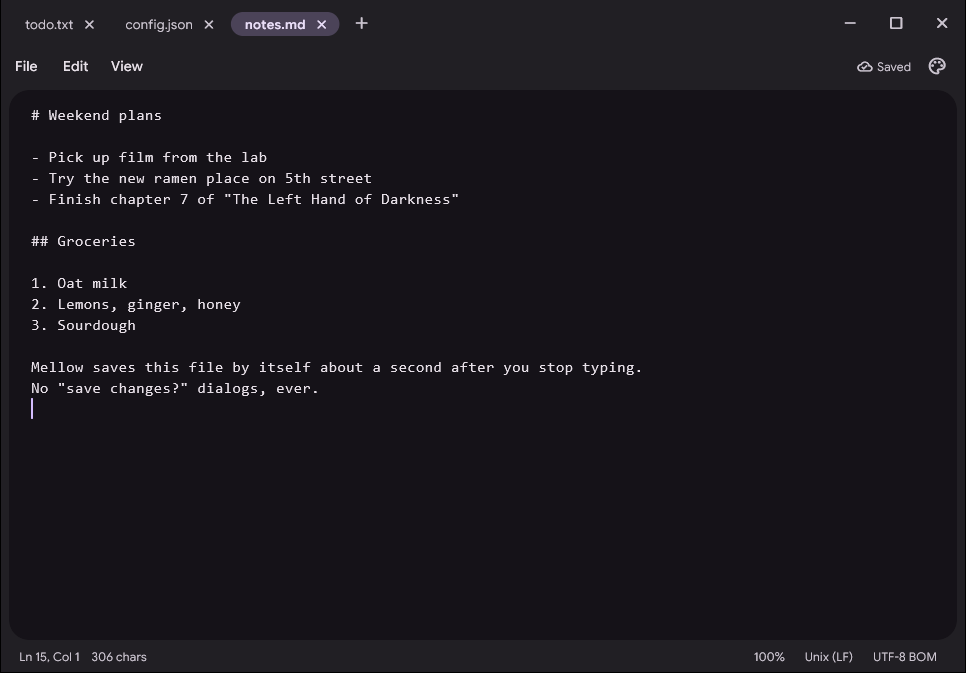
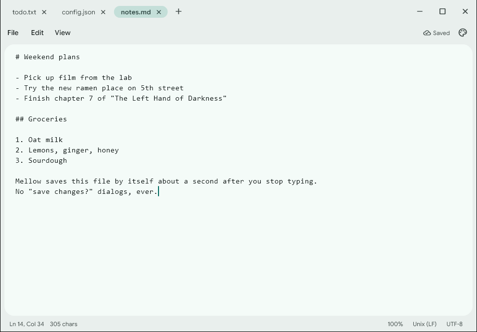
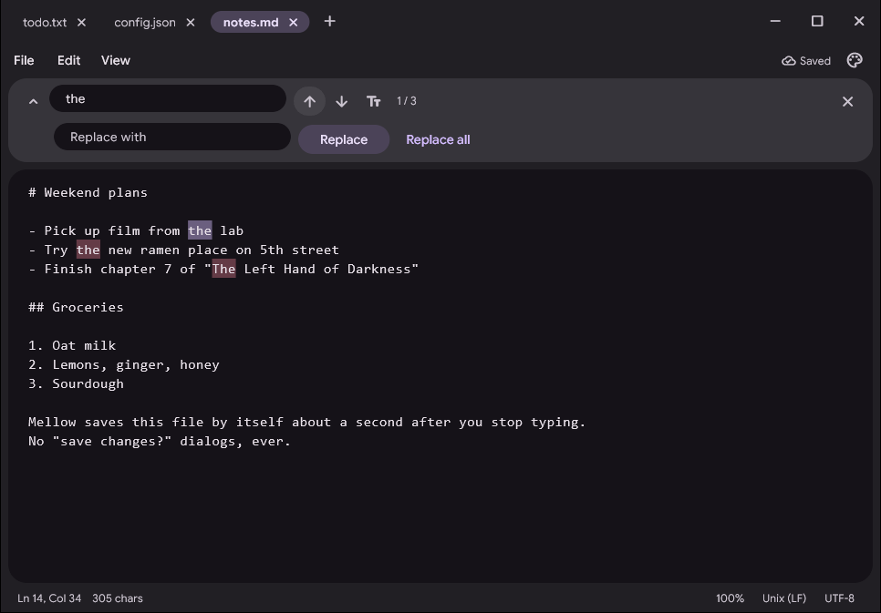
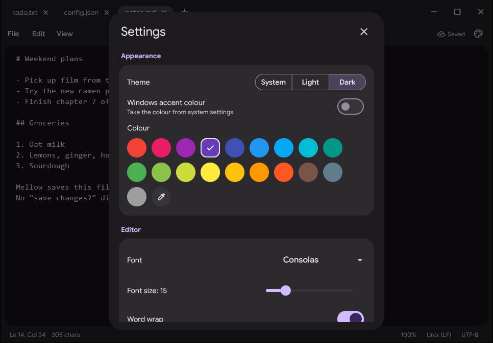
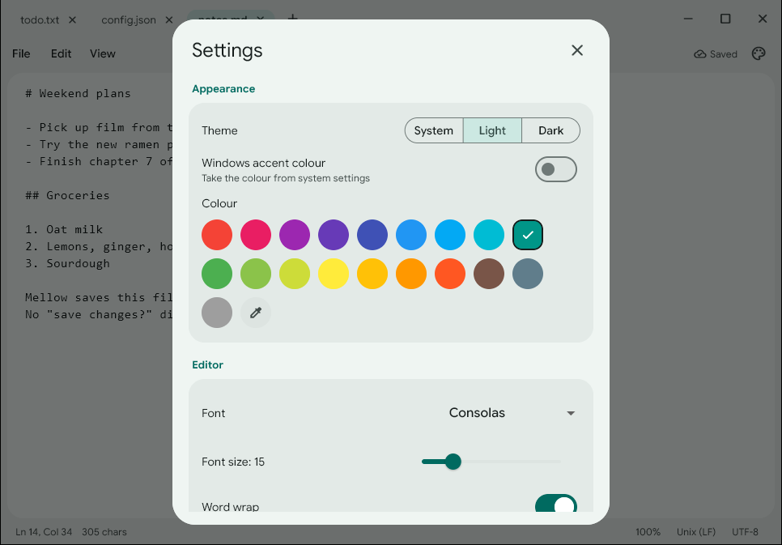
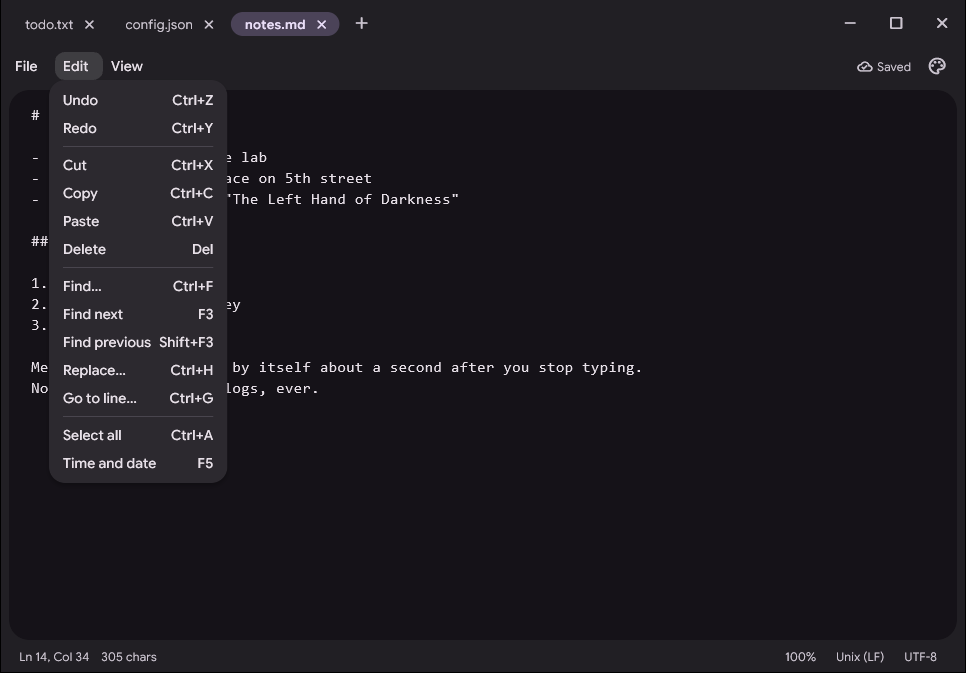
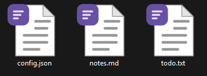

# Mellow

A soft, Material You notepad for Windows, built with Flutter.

Mellow works like the classic Windows Notepad: tabs, find and replace, go to line, word wrap,
zoom and a status bar. It also saves by itself and lets you pick its colours.



## Features

- **Autosave.** A file is written about a second after you stop typing, in its original
  encoding and line endings. Mellow never asks "save changes?".
- **Drafts that survive restarts.** Untitled tabs are kept as drafts and come back on the
  next launch along with the rest of the session. If you close a non-empty draft by mistake,
  you get 6 seconds to undo.
- **Tabs that tidy themselves.** Tabs you haven't touched for a while (24 hours by default,
  configurable, or never) are closed automatically.
- **Find and replace.** All matches are highlighted, with a match counter, case-sensitive
  mode, replace one or replace all, and go to line.
- **Encodings and line endings.** Detects UTF-8, UTF-8 with BOM, UTF-16 LE/BE and
  Windows-1251, plus Windows (CRLF) and Unix (LF) line endings, and writes them back
  unchanged.
- **Material You theming.** Light, dark or system theme, built from a seed colour: a preset
  palette, a custom colour picker, or the Windows accent colour.
- **Notepad habits.** Time and date (F5), word wrap, zoom, a status bar showing line, column,
  characters, zoom, line endings and encoding, a choice of font and size, and drag and drop
  to open files.
- **One window, many launches.** Opening a file while Mellow is already running adds a tab to
  the existing window. *File → New window* opens a second, independent window.
- **Its own file icon.** Files opened with Mellow get a document icon with the Mellow badge.
- **English and Russian interface**, chosen automatically from the system language or set by
  hand.

## Screenshots

| Light theme | Find and replace |
| --- | --- |
|  |  |

| Settings, dark | Settings, light |
| --- | --- |
|  |  |

| Edit menu | File icons in Explorer |
| --- | --- |
|  |  |

## Keyboard shortcuts

| Action | Shortcut |
| --- | --- |
| New tab | Ctrl+N or Ctrl+T |
| New window | Ctrl+Shift+N |
| Open / Save / Save as | Ctrl+O / Ctrl+S / Ctrl+Shift+S |
| Close tab | Ctrl+W |
| Next / previous tab | Ctrl+Tab / Ctrl+Shift+Tab |
| Find / Replace | Ctrl+F / Ctrl+H |
| Find next / previous | F3 / Shift+F3 |
| Go to line | Ctrl+G |
| Insert time and date | F5 |
| Zoom in / out / reset | Ctrl+= / Ctrl+- / Ctrl+0 |

## How it works

- **Workspace.** `lib/workspace.dart` owns the open tabs. It saves named files after a short
  pause, keeps untitled tabs in `%APPDATA%\Mellow\drafts\`, writes the tab list to
  `%APPDATA%\Mellow\session.json` and restores it on launch.
- **Single instance.** The first window listens on a loopback socket (`127.0.0.1:47631`).
  Later launches send their file paths there and exit, so files open as tabs in the existing
  window.
- **Encodings.** `lib/encoding.dart` detects the encoding and line endings when a file is read.
  In memory, text always uses `\n`. The original format is restored when the file is written.
- **Window.** Mellow draws its own title bar with the tabs in it (via `window_manager`) and
  remembers the window size and position.
- **Settings** are stored as JSON in `%APPDATA%\Mellow`. Set `MELLOW_DATA_DIR` to use another
  folder, for example for testing.

[OVERVIEW.md](OVERVIEW.md) has the full map of the code and the behaviour worth knowing.

## Install

### Download

1. Download `Mellow-<version>-windows-x64.zip` from the
   [latest release](https://github.com/Biomistik-Official/Mellow/releases/latest) and unpack it.
2. In the unpacked folder, run:

   ```powershell
   powershell -ExecutionPolicy Bypass -File .\install.ps1
   ```

Mellow is developed and tested on Windows 11 x64. Windows 10 may work but is untested. The
build is not code-signed, so Windows SmartScreen may warn you the first time it starts.

### Build from source

You need the
[Flutter SDK](https://docs.flutter.dev/get-started/install/windows/desktop), Visual Studio
Build Tools with the C++ workload, and Windows Developer Mode turned on.

```powershell
git clone https://github.com/Biomistik-Official/Mellow.git
cd Mellow
flutter build windows --release
powershell -ExecutionPolicy Bypass -File scripts\install.ps1
```

`install.ps1` installs Mellow for the current user only, into
`%LOCALAPPDATA%\Programs\Mellow`, and needs no admin rights. It adds a Start menu shortcut and
registers Mellow for `.txt`, `.log`, `.ini`, `.md` and `.json`. Windows doesn't let an app make
itself the default, so pick Mellow once in **Settings → Apps → Default apps**.

To remove Mellow, run the same script with `-Uninstall` (from the unpacked release folder, or
from `scripts\` in a clone):

```powershell
powershell -ExecutionPolicy Bypass -File .\install.ps1 -Uninstall
```

Your settings and drafts stay in `%APPDATA%\Mellow`.

## Development

```powershell
flutter test                                              # unit tests
flutter test integration_test/app_test.dart -d windows    # end-to-end, opens a real window
flutter analyze
```

## Known limitations

- The editor is a plain Flutter `TextField`. Files of several megabytes get slow, and files
  over 64 MB are refused.
- If another program changes a file that is open in Mellow, Mellow doesn't notice, and its
  next autosave overwrites those changes.
- There is no printing.
- `window_manager` is still used through its deprecated `legacy.dart` API.

## Credits

The interface uses [Google Sans Flex](assets/fonts/OFL.txt), licensed under the SIL Open Font
License.
